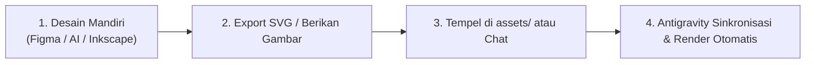

# 📋 CEA Ecosystem — Logo Design Task & Guidelines Tracker

Dokumen ini adalah acuan kerja (*design brief & task tracker*) mandiri untuk mendesain dan memfinalisasi 5 logo sub-brand **CEA Ecosystem** dengan panduan geometris, aturan visual (*stencil/broken lines*), dan checklist serah terima.

---

## 🎯 1. Aturan & Standar Teknis Desain (Design Specifications)

Seluruh logo wajib mematuhi parameter teknis berikut agar selaras (*cohesive*) dan terstandarisasi di seluruh ekosistem:

| Parameter | Spesifikasi Resmi | Keterangan |
| :--- | :--- | :--- |
| **Canvas / ViewBox** | `0 0 64 64` | Grid proporsional 1:1 berbasis 64px |
| **Gaya Visual** | *Flat Minimalist Line Art* | Garis tunggal tanpa bayangan, tanpa 3D/bevel, tanpa gradasi warna |
| **Ketebalan Garis (*Stroke*)** | `3.2 px` (Standar 1:1) | Skalabel (`stroke-width: 3.2`) |
| **Ujung & Sudut Garis** | `stroke-linecap="round"` `stroke-linejoin="round"` | Menghasilkan lekukan halus dan modern di setiap persimpangan |
| **Warna Default** | `stroke="currentColor"` atau `#000000` | Bersifat monokrom adaptif (100% fleksibel di latar terang/gelap) |
| **Aturan Ruang Kosong** | *Generous Breathing Room* | **DILARANG MEPET**: Beri jeda minimal 4–6 px antar elemen yang berdekatan |
| **Aksen Khusus** | *Broken Lines / Stencil Cuts* | Terdapat celah garis putus terbuka 4–6 px pada kontur untuk kesan dinamis & futuristik |

---

## 📌 2. Checklist & Rincian Konsep Setiap Logo

### [ ] 1. CEAMIS (Keuangan, Vault & Manajemen Aset)
> **Esensi:** *Security (Keamanan) + Wealth (Nilai Moneter) + Growth (Pertumbuhan Valuasi)*
- [ ] **Bentuk Utama:** Siluet perisai keamanan (*heraldic shield*) dengan sudut tegas di atas (`32, 6`) dan runcing di bawah (`32, 57`).
- [ ] **Simbol Dolar (`$`):** Berdiri tegak, berwibawa di pusat perisai dengan garis vertikal kokoh.
- [ ] **Panah Pertumbuhan (*Growth Arrow*):**
  - Ekor berupa *swoosh* melengkung di sudut kiri bawah luar perisai.
  - Batang panah melesat diagonal menembus bahu kanan perisai menuju kanan atas (`↗`).
- [ ] **Aksen Garis Putus (*Broken Line*):**
  - Dinding perisai kiri memiliki celah stencil terbuka (jeda 5–6 px).
  - Bahu kanan perisai memiliki bukaan agar panah tidak menabrak garis perisai.
- [ ] **Target File:** [`ecosystem/assets/ceamis.svg`](ecosystem/assets/ceamis.svg)

---

### [ ] 2. CEANOTE (Catatan, Ide & Manajemen Tugas)
> **Esensi:** *Clarity (Kejernihan) + Productivity (Produktivitas) + Order (Keteraturan)*
- [ ] **Bentuk Utama:** Lembar dokumen dengan lipatan sudut modern di kanan atas (*folded document*).
- [ ] **Baris Catatan:** 3 baris catatan horizontal bergradasi panjang tanpa ceklis/checklist (bebas distraksi).
- [ ] **Aksen Garis Putus (*Broken Line*):**
  - Garis tepi kiri dokumen memiliki bukaan celah stencil vertikal.
  - Garis dasar bawah memiliki jeda potong terbuka.
  - Baris catatan ke-2 memiliki aksen *dash break* (terputus di tengah).
- [ ] **Target File:** [`ecosystem/assets/ceanote.svg`](ecosystem/assets/ceanote.svg)

---

### [ ] 3. CEADEMY (Edukasi & Pembelajaran Digital)
> **Esensi:** *Prestige (Prestise) + Knowledge (Pengetahuan) + Future Literacy*
- [ ] **Bentuk Toga (Atas):** Mahkota belah ketupat topi toga wisuda (*mortarboard*) dengan kuncir rumbai di kanan.
- [ ] **Bentuk Buku (Bawah):** Bentangan sayap buku terbuka simetris dengan garis tulang buku (*spine*) di tengah.
- [ ] **Jeda Vertikal Bebas:** Topi toga dan buku terbuka **TIDAK MENYENTUH** satu sama lain (ada ruang nafas vertikal bersih).
- [ ] **Aksen Garis Putus (*Broken Line*):**
  - Sudut luar belah ketupat toga memiliki bukaan celah stencil.
  - Sayap lengkungan buku bawah memiliki jeda nafas simetris.
- [ ] **Target File:** [`ecosystem/assets/ceademy.svg`](ecosystem/assets/ceademy.svg)

---

### [ ] 4. CEASHOP (POS, Kasir & Ritel Toko)
> **Esensi:** *Speed (Kecepatan) + Commerce (Perdagangan) + Flow (Kelancaran Transaksi)*
- [ ] **Bentuk Utama:** Keranjang belanja (*shopping cart*) modern bersudut cepat.
- [ ] **Roda Ganda (*Dual Floating Wheels*):**
  - Dua lingkaran roda terpisah rapi di bawah lantai keranjang.
  - Memiliki **jarak bebas (*clear air gap*) minimal 4–5 px** dari dasar keranjang (*tidak menempel*).
- [ ] **Kisi Tengah:** Garis horizontal pembagi keranjang.
- [ ] **Aksen Garis Putus (*Broken Line*):**
  - Bibir atas dan lantai keranjang memiliki bukaan garis aerodinamis.
  - Kisi tengah terputus menjadi dua segmen seimbang (*speed dashes*).
- [ ] **Target File:** [`ecosystem/assets/ceashop.svg`](ecosystem/assets/ceashop.svg)

---

### [ ] 5. CEABOOTH (Photo Booth Interaktif & Kenangan)
> **Esensi:** *Moment Capture (Abadikan Momen) + Interactive (Interaktif) + Reality Print*
- [ ] **Bentuk Kamera (Atas):** Bodi kamera modern dengan prisma bidik di atas dan lensa aperture di tengah.
- [ ] **Frame Cetak Instan (Bawah):** Lembaran bingkai foto cetak polaroid instan mengambang di bawah kamera (*clean separation*).
- [ ] **Aksen Garis Putus (*Broken Line*):**
  - Sisi bahu kanan bodi kamera memiliki celah stencil terbuka.
  - Frame polaroid bawah memiliki bukaan sudut slot cetak.
- [ ] **Target File:** [`ecosystem/assets/ceabooth.svg`](ecosystem/assets/ceabooth.svg)

---

## 🚀 3. Alur Kerja Serah Terima Desain (Handover Workflow)

Setelah Anda selesai mendesain ikon-ikon tersebut, berikut langkah mudah untuk menerapkannya:

### Opsi Penyerahan Hasil:
1. **Opsi A (Jika Berupa Kode SVG / File SVG):**
   - Simpan langsung file Anda ke dalam folder `ecosystem/assets/` sesuai nama file di atas (`ceamis.svg`, `ceanote.svg`, dst.).
2. **Opsi B (Jika Berupa Gambar / Tangkapan Layar):**
   - Kirimkan gambarnya langsung di chat, dan saya akan mengonversi serta mengoptimasi kurva vektornya ke SVG 64x64 px secara presisi.

---

## 🛠️ 4. Langkah Otomatis Pasca-Penyerahan (Akan Dijalankan Antigravity)

Begitu Anda menyerahkan ikon final, saya akan langsung menjalankan otomatisasi berikut:
1. **Audit & Optimasi Vektor:** Memastikan ketebalan garis konsisten 3.2px, viewBox `64 64`, dan menghapus kode berlebih.
2. **Sinkronisasi Master Showcase (`cea-showcase-white.svg`):** Menggabungkan ke-5 logo ke dalam satu layout pameran.
3. **Render Ulang PNG Resolusi Tinggi:** Menjalankan script headless render untuk menghasilkan file `cea-showcase-white.png` (1500 × 540 px).
4. **Update Pratinjau Interaktif:** Memperbarui `preview.html` untuk pengujian ukuran 16px, 24px, 32px, 48px, dan mode gelap/terang.
5. **Update README Ekosistem:** Memperbarui dokumentasi filosofi dan panduan brand.
