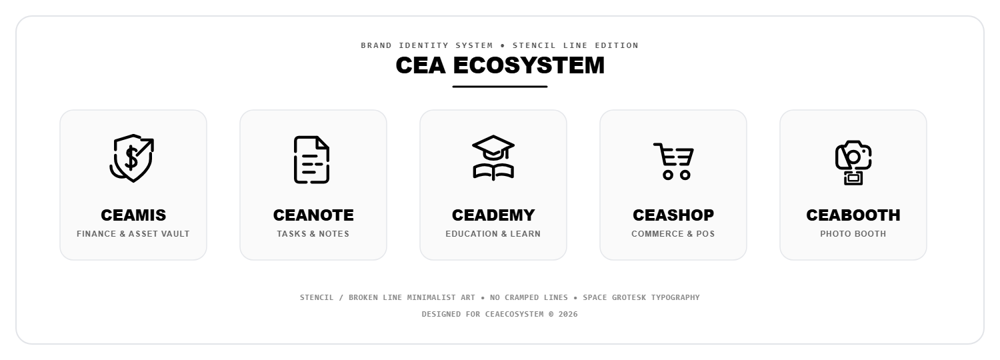
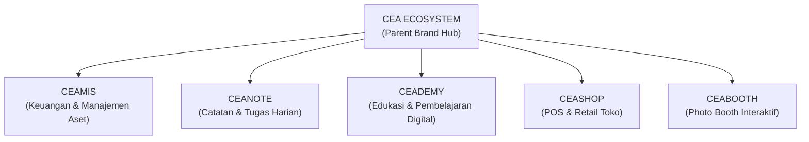

# CEA Ecosystem — Brand Guidelines & Identity System

> Dokumen resmi arsitektur merek, filosofi visual, dan pedoman desain untuk ekosistem produk **CEA**.

---

 

## 1. Ikhtisar & Arsitektur Ekosistem

Ekosistem **CEA** dibangun di atas filosofi desain yang kohesif: **minimalis, presisi geometris, dan gaya garis putus (stencil/broken-line cuts)**. Seluruh sub-brand berbagi DNA visual yang sama berupa *flat minimalist line art* dengan ketebalan garis tunggal 3.2px yang konsisten, bukaan celah aerodinamis (*negative space breaks*), tanpa garis bertumpuk atau mepet.

---

## 2. Rincian Sub-Brand & Filosofi Bentuk

### 1. CEAMIS (Keuangan & Manajemen Aset)
- **Filosofi & Bentuk:** Perisai proteksi keamanan (*shield*) dengan simbol mata uang dolar (`$`) di pusatnya, serta panah pertumbuhan dinamis yang melesat menembus bahu kanan perisai dengan ekor swoosh di kiri bawah.
- **Makna:** Melambangkan perlindungan aset finansial yang kokoh (*security*), kepemilikan nilai moneter (*wealth*), dan pertumbuhan valuasi portofolio yang eksponensial (*growth*).
- **Karakter Garis:** Garis presisi 3.2px dengan celah udara lapang (*generous breathing room*), bebas senggolan garis, dan terbaca jelas pada skala kecil.
- **Implementasi Ideal:** Dashboard finansial, header modul laporan laba-rugi, wallet portofolio, dan aplikasi perbankan digital.
- **Asset File:** [`assets/ceamis.svg`](assets/ceamis.svg)

---

### 2. CEANOTE (Catatan & Produktivitas Tugas)
- **Filosofi & Bentuk:** Dokumen bersudut lipat (*folded paper*) modern dengan tiga baris catatan lapang dan presisi tanpa ceklis/checklist.
- **Makna:** Alur kerja terstruktur, kejelasan ide, dan pengarsipan catatan rapi yang bebas distraksi visual.
- **Karakter Garis:** Garis outline tegas 3.2px dengan jarak margin lega (*spacious padding*), tanpa garis berhimpitan.
- **Implementasi Ideal:** Ikon aplikasi catatan/writing, widget ide harian, panel dokumentasi proyek.
- **Asset File:** [`assets/ceanote.svg`](assets/ceanote.svg)

---

### 3. CEADEMY (Edukasi & Pembelajaran)
- **Filosofi & Bentuk:** Mahkota topi toga akademik (*mortarboard*) di atas dan bentangan buku terbuka di bawah dengan jarak vertikal lapang.
- **Makna:** Prestise ilmu pengetahuan, transmisi literasi digital, dan pencapaian akademik institusional.
- **Karakter Garis:** Komposisi aksial simetris dengan pemisah ruang kosong alami antara toga dan buku.
- **Implementasi Ideal:** Platform e-learning, portal kelas digital, sertifikasi dan kurikulum online.
- **Asset File:** [`assets/ceademy.svg`](assets/ceademy.svg)

---

### 4. CEASHOP (POS & Manajemen Toko Retail)
- **Filosofi & Bentuk:** Keranjang belanja (*shopping cart*) modern dengan roda ganda presisi dan kisi horizontal lapang.
- **Makna:** Kelancaran transaksi kasir POS, kemudahan belanja retail e-commerce, dan perputaran produk toko.
- **Karakter Garis:** Siluet dinamis dengan jeda ruang udara (*clear air gap*) yang lapang antara lantai keranjang dan roda, tanpa garis mepet.
- **Implementasi Ideal:** Terminal kasir Point of Sale (POS), tombol checkout keranjang belanja, inventaris toko.
- **Asset File:** [`assets/ceashop.svg`](assets/ceashop.svg)

---

### 5. CEABOOTH (Photo Booth Interaktif)
- **Filosofi & Bentuk:** Bodi kamera bold modern dengan lensa melingkar dan lembar bingkai foto cetak polaroid instan terpisah di bawahnya.
- **Makna:** Dokumentasi momen interaktif, kebersamaan nyata di event, dan cetakan kenangan instan.
- **Karakter Garis:** Siluet proporsional dengan jarak bebas yang jelas antara bodi kamera dan frame cetak foto.
- **Implementasi Ideal:** Antarmuka layar kiosk photo booth, live preview camera, template frame foto digital.
- **Asset File:** [`assets/ceabooth.svg`](assets/ceabooth.svg)

---

## 3. Brand Guidelines (Pedoman Visual Ekosistem)

### A. Palet Warna (Color System)
- **Tema Utama (Monokrom Primer):**
  - Hitam Absolut: `#000000` (pada media berlatar putih bersih `#FFFFFF`).
  - Putih Bersih: `#FFFFFF` (pada mode gelap `#0D1117` / `#121212`).
- **Adaptasi Satu Warna (Solid Monochrome):**
  Seluruh logo dirancang berbasis vektor garis tunggal tanpa isian gradasi, sehingga 100% kompatibel diwarnai dengan satu warna solid identitas modul (misal: Hijau Emerald untuk Finansial, Biru Kobalt untuk Edukasi, dsb.).

### B. Tipografi (Typography)
- **Font Keluarga Utama:** **Space Grotesk**
- **Karakter:** Sans-serif bernuansa monospace geometris, modern, tech-savvy, dan futuristik.
- **Hirarki Penulisan:**
  - `H1 / Brand Name`: Space Grotesk Bold / SemiBold (Weight 600–700), *Tracking/Letter-spacing:* `-0.02em`.
  - `Subtitle / Tagline`: Space Grotesk Medium (Weight 500), *Tracking:* `+0.05em` (Uppercase).
  - `Body / UI`: Inter / System Sans-serif untuk kenyamanan baca panjang.

### C. Aturan Ruang Kosong (Clear Space & Whitespace)
- Selalu sisakan zona aman minimal **1X** (setara dengan lebar stroke perisai atau tinggi roda keranjang) di sekeliling logo tanpa gangguan elemen teks atau grafis lain.
- Ruang kosong (*generous breathing room*) menjamin siluet bold minimalis tetap bernapas, bebas senggolan garis, dan mempertahankan kesan modern & mewah.

### D. Skala Ukuran & Ketebalan Garis (Grid & Stroke System)
- **Base Grid:** `64 x 64 px` viewport.
- **Stroke Width:** `3.2 px` (skala 1:1, bold minimalist), `stroke-linecap="round"`, `stroke-linejoin="round"`.

### E. Gaya Garis Putus & Stencil (Broken Lines & Negative Space)
- Setiap siluet logo memiliki **celah garis putus (*stencil cuts*)** selebar 4–6 px yang sengaja dibuka pada sudut atau kontur tepi tertentu.
- Berfungsi memberikan efek aerodinamis, modernitas tinggi (*high-tech signature*), dan menghilangkan kesan garis tertutup yang kaku.
- **Ukuran Skalabilitas:**
  - `16 px`: Favicon / Taskbar Icon (tetap terbaca siluetnya).
  - `24–32 px`: Navigation bar & Mobile header.
  - `48–64 px`: Dashboard hero & Card branding.
  - `128 px+`: Splash screen, Signage, & Merchandise print.

---

## 4. Pratinjau Interaktif

Untuk melihat simulasi perbandingan seluruh logo dalam mode terang/gelap, uji ukuran skala (16px s/d 64px), dan mock-up kartu:
👉 **Buka file: [`preview.html`](preview.html)** langsung di browser Anda.
